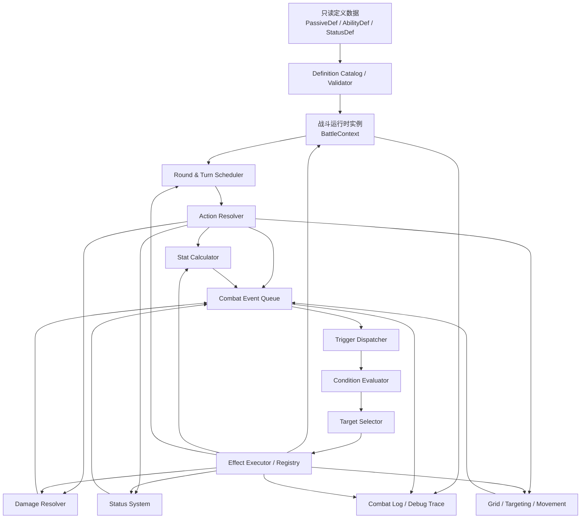
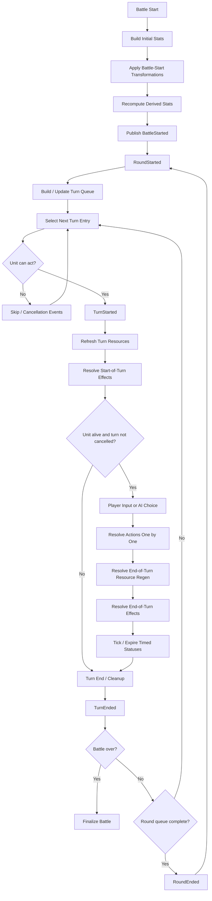

# 回合制战斗与被动效果系统设计文档

> **文档类型**：面向 AI 编程助手的系统设计规范（可作为实现任务的长期上下文）  
> **版本**：1.0  
> **目标**：设计一套可扩展、可预测、可测试的数据驱动回合制战斗系统，参考《Mewgenics》公开可观察到的战斗玩法，同时使用明确的模块边界和效果结算约定。  
> **重要声明**：本文不是《Mewgenics》源码逆向文档。文中“参考游戏行为”来自公开玩法资料及公开模组格式说明；其内部实现细节未公开或无法确认的部分，一律作为本项目自己的设计选择，而不声称是原游戏的内部架构。

---

## 0. 给 AI 编程助手的最高优先级指令

实现本系统时必须遵守以下规则：

1. **先理解现有工程和技术栈，再修改代码。** 不要假定项目使用 Godot、Unity、C++ 或其他引擎；先检查项目文件、现有命名、数据流和测试方式。
2. **不要把每个被动技能实现成独立的大型类。** 被动技能通常应由数据定义、触发条件、目标选择器和可复用效果组成。只有出现真正的新机制时，才新增通用效果处理器。
3. **不要使用任意遍历顺序决定玩法。** 禁止依赖哈希表遍历顺序、文件加载顺序、内存地址或未定义的容器顺序决定结算结果。必须按本文指定的 phase、priority 和稳定 tie-break 规则执行。
4. **任何会改变战斗状态的效果都必须经过统一的 BattleContext / Battle API。** 不允许被动、状态或技能绕过统一入口直接修改其他模块的内部字段。
5. **所有触发行为必须可追踪。** 至少能记录事件、命中的触发器、条件判断结果、效果执行、伤害结算、状态变化、死亡和召唤。
6. **不要使用 `eval` 或任意脚本字符串执行配置。** 条件表达式、目标选择和效果类型必须来自受控的类型/枚举/注册表。
7. **明确区分定义数据与运行时数据。** PassiveDef、AbilityDef、StatusDef 等定义资源应当只读；每只单位身上的 PassiveRuntime、StatusInstance、ActionResource 等才保存运行时状态。
8. **一次性变换不能在每次属性重算时重复执行。** 例如“战斗开始时交换最高与最低属性”应当只在规定的初始化阶段执行一次，不能放到普通属性计算函数里反复交换。
9. **先实现确定性和测试，再增加复杂效果。** 随机性必须来自可注入、可播种的 RNG 服务；不能在效果处理器中到处直接调用全局随机函数。
10. **遇到本文未定义的规则时，优先提出一个局部、明确、可测试的默认行为，并记录到设计决策中；不要凭空复制《Mewgenics》的“内部规则”。**

---

## 1. 设计目标与非目标

### 1.1 设计目标

系统需要支持：

- 网格地图中的回合制战斗、移动、攻击、技能、道具、地形和范围目标。
- 由速度/先攻决定行动顺序，允许速度变化影响后续行动顺序。
- 普通回合、额外回合、行动资源刷新和行动限制。
- 被动技能在指定事件或时间窗口触发。
- 状态效果、持续时间、层数、驱散、免疫、伤害持续效果及相互作用。
- 属性加成、属性倍率、属性变换和衍生属性计算。
- 命中、伤害、护盾、减伤、反击、吸血、死亡、复活、召唤和连锁触发。
- 一个效果组合被许多被动、技能、装备、突变、特质或地形规则重复使用。
- 可预测的结算顺序、可复现的随机结果、可读的战斗日志和自动化测试。
- 后续可以用数据新增大量技能，而不需要为每个技能修改战斗核心代码。

### 1.2 非目标

第一阶段不要求：

- 复刻《Mewgenics》的完整数值、所有职业、所有地图、全部技能或全部隐藏规则。
- 把所有规则都写成通用的视觉化节点编辑器。
- 支持不受限制的玩家自定义脚本执行。
- 使用分布式/网络确定性架构。即使将来联网，也先保持单机核心逻辑的确定性。
- 强制采用某个特定引擎、语言或 ECS 框架。

### 1.3 核心设计原则

**内容数据化，机制代码化，时机显式化，结算可追踪化。**

- 数据：被动有哪些效果、条件、参数、目标、触发次数限制。
- 机制：如何造成伤害、施加状态、恢复资源、移动单位。
- 时机：在行动前、行动后、回合开始、回合结束、死亡前还是死亡后触发。
- 记录：为什么触发、为何没有触发、读取了什么数值、修改了什么状态。

---

## 2. 从《Mewgenics》借鉴什么

公开玩法资料中可观察到以下适合借鉴的特征：

1. **轮次与单位回合分离**：战斗轮次中，单位按先攻顺序获得行动机会；有些单位或效果还能产生额外行动。
2. **行动顺序可能动态变化**：速度或控制状态改变后，后续行动顺序可能调整；相同先攻的处理也需要有明确的规则。
3. **回合开始和回合结束是不同的结算窗口**：行动资源刷新、回合开始状态、回合结束资源恢复和回合结束状态并非任意插入的一组回调，而是有明确语义的时间点。
4. **效果种类广而复用**：公开模组资料里，被动定义可包含直接属性修改和一组被动效果；效果资源中也能看到与回合开始、回合结束、死亡、队友消耗法力等语义相关的效果。
5. **状态并非单一计时器**：状态可能即时触发、在回合开始触发、在回合结束触发，或者只在特定事件发生时触发；层数、持续时间和状态交互应独立建模。

这些是对公开玩法/模组资料的归纳，不代表我们知道原游戏内部的实际类结构。本文后续的模块、接口、调度器和数据格式都是**本项目推荐采用的设计**。

### 2.1 参考资料

- 《Mewgenics》回合规则与行动顺序的公开 Wiki 页面：<https://mewgenics.wiki.gg/wiki/Round>
- 回合开始触发效果列表：<https://mewgenics.wiki.gg/wiki/List_of_effects_that_trigger_on_turn_start>
- 状态效果概览：<https://mewgenicswiki.org/wiki/status-effects>
- MewgenicsScriptResources（公开模组脚本格式及 passives/events 等资料）：<https://github.com/ombrellus/MewgenicsScriptResources>
- Mewgenics Modding Documentation（公开数据/schema 汇编，作者也说明部分条目需要验证）：<https://github.com/Jzurcc/Mewgenics-Modding-Documentation>

引用这些资料时要保持谨慎：Wiki 和模组文档可帮助理解可观察规则与数据形态，但它们不是游戏源代码，也不保证每一条细节都完全准确。

---

## 3. 总体架构

### 3.1 模块关系



### 3.2 模块职责

| 模块 | 必须负责 | 不应负责 |
|---|---|---|
| `DefinitionCatalog` | 加载、索引、验证只读定义；检查 ID、字段、效果类型 | 执行战斗效果 |
| `BattleContext` | 保存一次战斗的权威状态与服务引用 | 自行推断所有规则 |
| `TurnScheduler` | 管理轮次、单位行动顺序、主回合和额外回合 | 直接造成伤害或施加状态 |
| `ActionResolver` | 验证行动、支付代价、组织行动结算步骤 | 直接实现所有被动技能 |
| `StatCalculator` | 根据基础值和修正规则计算有效属性与衍生属性 | 在普通重算中重复执行一次性变换 |
| `DamageResolver` | 统一处理命中、减伤、护盾、生命变化、死亡判定 | 自行扫描所有被动定义 |
| `StatusSystem` | 添加、刷新、叠层、驱散、tick、过期、免疫 | 自己创建无边界的递归事件链 |
| `EventQueue` | 有序保存战斗事件及因果关系 | 修改游戏状态 |
| `TriggerDispatcher` | 找出当前事件对应的订阅效果并排序 | 自行决定伤害公式或状态规则 |
| `ConditionEvaluator` | 使用受控条件树判断是否满足触发条件 | 执行任意脚本 |
| `TargetSelector` | 依据事件上下文、阵营、距离、范围、状态选择目标 | 修改目标状态 |
| `EffectRegistry` | 根据 `EffectType` 找到执行器 | 包含每个技能的专属分支 |
| `CombatLog` | 记录事件与状态变化，便于 UI、回放和调试 | 成为战斗真相的唯一数据源 |

### 3.3 单一权威状态

`BattleContext` 是一次战斗的权威状态入口，至少包含：

- `BattleState`：地图、单位、阵营、位置、环境状态。
- `TurnState`：当前轮次、当前行动单位、当前回合类型、待处理行动队列。
- `UnitRuntime`：生命、资源、基础属性引用、状态实例、被动实例、行动资源。
- `EventQueue`：当前待处理事件队列。
- `EffectExecutionQueue`：由事件触发的待执行效果队列。
- `RngService`：带种子的随机服务。
- `CombatLog`：有序日志和调试 trace。
- `DefinitionCatalog`：只读的技能、被动、状态、单位和效果定义。

禁止用多个模块各自持有一份可独立修改的单位生命、属性或状态副本。允许有缓存，但缓存必须可失效、可重建，且不是权威数据源。

---

## 4. 核心领域模型

下文是逻辑模型，不强制照抄类名。若项目使用 Godot，可以用 `Resource`/`RefCounted` 或纯数据对象实现；若是 C++/其他引擎，则用普通结构体与服务类实现。

### 4.1 单位定义和运行时单位

```text
UnitDef (只读定义)
- id
- base_stats
- base_actions
- movement_profile
- team/faction defaults
- starting_passives
- starting_statuses
- abilities

UnitRuntime (单次战斗中的单位状态)
- entity_id                 // 本战斗内唯一且稳定
- definition_id
- team_id
- position
- base_stats_snapshot       // 初始化后的基础输入快照（按项目需要）
- current_hp / max_hp
- resources                 // mana 等资源
- status_instances[]
- passive_instances[]
- action_resources
- life_state                // Alive / Downed / Dead / Removed
- turn_flags                // 本单位本轮/本回合是否行动、是否触发过一次性效果等
- spawn_sequence            // 确定性 tie-break
```

`entity_id` 必须在战斗内唯一且稳定；不可用数组索引代表长期实体身份，因为召唤、死亡移除和排序会使索引变化。

### 4.2 被动定义与运行时被动实例

```text
PassiveDef (只读定义)
- id
- display_name
- description
- tags[]
- stat_modifiers[]
- stat_transforms[]
- effects[]
- level_variants[]

PassiveRuntime (某个单位持有该被动的实例)
- instance_id
- owner_entity_id
- passive_def_id
- level
- acquisition_sequence
- enabled
- per_battle_counters{}
- per_round_counters{}
- per_turn_counters{}
- custom_state{}             // 仅用于确有必要的状态，不得存放可直接从世界状态推导的数据
```

规则：

- 两只猫可以共享同一个 `PassiveDef`，但必须拥有不同的 `PassiveRuntime`。
- 被动升级应解析成确定的有效定义或 level variant，不要复制并随意修改共享定义。
- `custom_state` 只存无法由现有世界状态推出的信息，例如“每场战斗最多触发 1 次”的触发次数。
- 如果触发次数可以由事件日志或状态准确推导，也可以选择存计数，但必须确保保存/恢复和重播的一致性。

### 4.3 效果定义

建议每个效果拥有以下字段：

```text
EffectDef
- id                         // 在所属定义中唯一
- type                       // enum / registered key
- trigger                    // 何时有资格触发；静态属性修正可没有 trigger
- condition                  // 可选、受控条件树
- target                     // 受控目标选择器
- parameters                 // 对当前 type 的参数
- phase                      // 所属结算阶段
- priority                   // 同阶段内的显式排序权重；默认 0
- trigger_limit              // 可选：每次行动/每回合/每轮/每场战斗
- once_key                   // 可选：用于一次性触发防重
- enabled                    // 是否启用
```

不要设计一个能够表示任意程序的“万能效果 JSON”。`type` 的种类可以扩展，但每一种 type 必须有固定 schema、参数验证、执行器和测试。

### 4.4 战斗事件

```text
CombatEvent
- event_id
- type
- phase                      // Before / After / StateChanged 等阶段语义
- source_entity_id?           // 发起者，可为空
- target_entity_id?           // 主要目标，可为空
- ability_id? / effect_id?
- action_id? / parent_event_id?
- amount? / damage_type? / resource_type?
- position? / tile_id?
- tags[]
- sequence_number
- depth                       // 事件因果链深度，用于防止无限递归
- payload                    // 强类型额外字段；不得随意使用不透明字符串
```

具体事件类型可以包括：

- `BattleStarted`, `RoundStarted`, `RoundEnded`
- `TurnStarted`, `TurnEnded`, `ExtraTurnQueued`
- `ActionDeclared`, `ActionRejected`, `ActionStarted`, `ActionCompleted`, `ActionCancelled`
- `MovementStarted`, `UnitMoved`, `UnitEnteredTile`, `UnitLeftTile`
- `AbilityCastStarted`, `ResourceCostPaid`, `AbilityCastCompleted`
- `AttackDeclared`, `AttackHit`, `AttackMissed`
- `BeforeDamage`, `DamageCalculated`, `DamageApplied`, `DamagePrevented`
- `HealingApplied`, `ResourceGained`, `ResourceSpent`
- `StatusApplied`, `StatusStackChanged`, `StatusTicked`, `StatusRemoved`, `StatusExpired`
- `UnitDied`, `UnitRevived`, `UnitSpawned`, `UnitRemoved`
- `BeforeUnitDeath`, `AfterUnitDeath`

事件的命名和 payload 要表达**已发生事实**还是**即将发生的机会**。例如：

- `BeforeDamage`：伤害尚未正式提交，符合规则的效果可修改/取消候选伤害。
- `DamageApplied`：实际扣血/扣盾已提交，只能响应结果，不应反过来修改已经计算完的同一笔伤害。
- `UnitDied`：死亡状态已提交。
- `BeforeUnitDeath`：允许复活、替死或阻止死亡的规则进行干预。

不要复用一个含义模糊的 `OnDamage` 同时表达攻击开始、伤害计算和伤害已经落地。

---

## 5. 被动效果如何协作

### 5.1 完整的触发流程

一条被动效果从事件发生到执行完毕，必须经过同样的流程：

1. 系统产生一个有语义的 `CombatEvent`。
2. 事件进入 `EventQueue`，按确定的队列规则取出。
3. `TriggerDispatcher` 查询订阅该事件类型的效果，不要每次遍历全世界所有定义。
4. 过滤已禁用、所有者已失效、触发次数已用完的实例。
5. 按触发 phase、priority 和稳定 tie-break 规则排序。
6. `ConditionEvaluator` 判断每个效果条件，并记录 True/False 以及失败原因。
7. `TargetSelector` 解析目标；没有合法目标时，效果按定义的失败策略结束。
8. 检查成本和限制（若效果有成本、次数限制或冷却）。
9. 将效果提交至 `EffectExecutionQueue`，按当前结算窗口执行。
10. 效果通过统一 API 修改战斗状态；任何由此产生的新事件加入队列，不允许无边界同步递归。
11. 更新触发计数和运行时状态。
12. 记录效果结果、产生的子事件及关联 ID。

### 5.2 必须区分事件顺序和效果顺序

- **事件顺序**：例如一次攻击先发布 `AttackDeclared`，再进行命中判断，最后可能产生 `DamageApplied`。
- **同一事件的订阅效果顺序**：多个被动都订阅 `DamageApplied` 时，它们如何先后运行。
- **效果内部步骤顺序**：例如造成伤害、确认目标死亡、发放击杀资源。

三种顺序不同。不能通过给每个被动加一个全局整数 priority 就解决所有问题。首先由行动解析器定义游戏流程，再由 phase/priority 只决定同一触发窗口中的相关效果顺序。

### 5.3 同一触发窗口的排序规则

对所有符合条件的效果，采用以下稳定排序键：

1. `phase_rank`：由系统定义的固定阶段顺序。
2. `priority`：较高或较低优先级哪边先执行由项目统一指定。推荐 **数值越小越先执行**，避免模糊；全项目保持一致。
3. `owner_turn_order_rank`：在当前时间点的稳定单位顺序（例如当前行动单位、其队友按战斗队列顺序、敌方单位按队列顺序）。
4. `passive_acquisition_sequence`：被动获得顺序。
5. `effect_definition_index`：效果在定义中的顺序。
6. `instance_id`：最终稳定 tie-break。

这套排序规则只作为同一结算窗口的 tie-break。对于“必须在伤害前防止伤害”和“伤害后回血”这种语义不同的行为，必须用 `BeforeDamage` 与 `DamageApplied` 等不同事件/phase 表示，不能只靠 priority。

### 5.4 效果类型建议

至少支持下列基础原子效果：

- 属性：`AddStatModifier`, `RemoveStatModifier`, `AddStatTransform`
- 状态：`ApplyStatus`, `RemoveStatus`, `ModifyStatusStacks`, `CleanseStatus`
- 伤害：`DealDamage`, `ModifyPendingDamage`, `PreventDamage`, `ReflectDamage`
- 治疗：`Heal`, `ModifyPendingHealing`
- 资源：`GainResource`, `SpendResource`, `RefundResource`
- 行动：`GrantAction`, `ConsumeAction`, `GrantExtraTurn`, `ChangeInitiative`
- 空间：`MoveUnit`, `PushUnit`, `PullUnit`, `TeleportUnit`, `SpawnUnit`
- 目标控制：`ChangeTarget`, `Taunt`, `ApplyControl`
- 信息/标记：`AddTag`, `RemoveTag`, `MarkTarget`
- 概率：不要单独作为最终效果；应作为触发条件或包装器对内部效果运行 RNG。

组合效果时优先复用原子效果。例如“击杀后恢复 3 点法力并获得 1 层力量增强”应当是同一 trigger 下的两个 effects，而不是一个专有 `KillAndRestoreManaAndGainStrength` 执行器。

---

## 6. 回合、轮次和行动调度

### 6.1 术语

- **Round / 轮次**：调度器完成一轮主行动的周期性概念。
- **Turn / 单位回合**：某个单位获得一段行动权的过程。
- **Action / 行动**：移动、基础攻击、施法、道具使用等具体操作。
- **Extra Turn / 额外回合**：额外授予单位的一段行动权，与普通行动资源刷新之间的关系必须明确。
- **Bonus Action / 额外行动**：在当前回合内额外得到的一次行动；它不一定等价于一个完整额外回合。

不要将这些概念在代码中都叫 `turn`。API 和日志必须能够区分它们。

### 6.2 主行动顺序

建议由 `TurnScheduler` 管理一个可重排的行动队列。

- 初始 initiative 由属性和单位规则计算；常见设计是 `Speed` 影响 initiative，但公式可配置，不要把某一个游戏的公式硬编码进通用架构。
- 每场战斗开始时，为同 initiative 的单位生成稳定的 tie-break 值，保存至战斗状态。不要每次重算队列时重新随机，否则相同速度单位会不断交换位置。
- 速度、迟缓、加速、强制先后手等变化可以调整尚未执行的单位顺序。
- 已完成主回合的单位不能仅因速度变化而再获得一次主回合；额外回合必须通过 `ExtraTurnQueued` 或明确的 scheduler API 授予。
- 单位死亡、眩晕、移出战场或不可行动时，调度器按显式规则跳过、取消或保留其行动机会。
- 队列中每一项必须标识 `turn_kind`（Main / Extra / Scripted 等）、owner、sequence 和是否已开始。

### 6.3 建议的轮次/单位回合流水线



**注意**：这只是本项目推荐的一种顺序。某款游戏可能把状态 tick 放在回合开始，也可能把资源恢复放在持续伤害前后。必须通过 `StatusDef` 的明确 tick 时机和本文结算规则定义清楚，不能让各状态自己在不受控的地方倒计时。

### 6.4 单位回合开始

推荐固定顺序：

1. 验证单位还在战场且可进入回合。
2. 发布 `TurnStarted`（表示“回合开始机会”已发生）。
3. 刷新基础行动资源：移动、基础攻击、武器/道具等按定义刷新。
4. 处理标记为 `START_OF_TURN_PRE_ACTION` 的状态 tick/effect。
5. 处理 `TurnStarted` 的被动触发效果。
6. 处理以上步骤产生的连锁事件和死亡结算。
7. 再次确认单位仍存活、没有跳过回合或被控制效果取消回合。
8. 将行动权交给玩家或 AI。

此处选择“先刷新行动资源，再处理回合开始效果”。如果某个效果要让单位本回合失去行动资源，它可以在资源刷新后移除资源；如果某个状态应当在资源刷新前杀死单位，则将它定义成 `START_OF_TURN_PRE_REFRESH`，并在流水线里明确插入这个子阶段，而不是用负 priority 冒充。

### 6.5 单位回合结束

推荐固定顺序：

1. 单位主动结束回合，或被系统判定不能继续行动。
2. 发布 `TurnEnding`（若有需要）并处理结束前效果。
3. 处理 `END_OF_TURN_PRE_REGEN` 状态 tick。
4. 计算并应用法力/生命等回合结束恢复；受阻、减疗、疲劳等规则在统一资源 API 中计算。
5. 处理 `END_OF_TURN_POST_REGEN` 效果。
6. 推进明确规定在回合结束时 tick 的状态持续时间，并处理过期。
7. 排空由这些变化产生的有限反应队列，完成死亡/召唤/反击等结算。
8. 发布 `TurnEnded`。

如果项目需要“燃烧在回合开始造成伤害、回合开始时层数减少”，或者“再生在回合结束回血”，就把这些语义写在状态定义的 tick 配置中。不要在 `if status.name == "Burn"` 的全局逻辑中写特例。

---

## 7. 一次行动如何结算

一次攻击、施法或道具使用都应由 `ActionResolver` 组织成事务化流水线。

### 7.1 行动结算标准步骤

1. **Declare**：创建 `ActionContext`，记录行动者、技能 ID、目标意图、成本和 action_id。
2. **Validate**：检查行动者生命状态、控制状态、行动资源、法力成本、距离、视线、冷却、目标合法性。
3. **Before Action Window**：发布 `ActionDeclared`/`AbilityCastStarted` 等前置事件；允许明确支持的效果修改候选目标/成本/结果。若行动被取消，发布取消事件并按规则决定是否退款。
4. **Commit Cost**：支付法力、消耗行动次数或道具。支付后发布 `ResourceCostPaid` / `ResourceSpent`。默认规则：只有已通过验证且进入正式执行的行动才支付成本。
5. **Resolve Movement / Targeting**：如果行动包含位移，先按能力定义执行，再按最终位置确定目标。能力可以显式声明“先锁定目标再移动”。
6. **Resolve Hit / Miss**：通过统一 `HitResolver` 和 `RngService` 判断命中、闪避、格挡等。
7. **Resolve Payload**：执行伤害、治疗、施加状态、位移、召唤等效果。一个技能可有多个 payload，顺序由定义中的 `step_index` 决定。
8. **Resolve Reactions**：每个已提交的状态变化发出事件，触发反应效果，并按队列规则执行。
9. **Resolve Deaths**：将 HP 达到死亡阈值的单位送入死亡流程；不得在尚未处理完同一原子伤害结果之前让其不确定地消失。
10. **After Action Window**：发布命中后、造成伤害后、施法完成后、行动完成后等事件。
11. **Cleanup**：释放临时上下文，更新行动资源和 UI，重新计算必要的衍生属性/行动顺序。

### 7.2 一笔攻击的推荐顺序

```text
AttackDeclared
  -> 验证目标、距离、视线、攻击资源
  -> BeforeAttack 反应窗口
  -> 确认行动成本
  -> 命中判定
      -> miss: AttackMissed -> OnMiss 反应 -> ActionCompleted
      -> hit:
          -> AttackHit
          -> 构建 PendingDamage
          -> BeforeDamage 修正/取消候选伤害
          -> 计算护甲、抗性、易伤、暴击、减伤等
          -> 应用护盾/护甲吸收和 HP 变化
          -> DamageApplied
          -> 检查并提交死亡候选
          -> OnDamageDealt / OnDamageTaken / OnHit 等反应
          -> 处理由反应产生的伤害、状态或治疗
          -> 完成当前反应队列
          -> 提交死亡流程
          -> ActionCompleted
```

系统必须明确 `OnHit`、`OnDamageDealt`、`OnDamageTaken`、`OnKill` 之间的具体含义。建议：

- `OnHit`：命中已经确认，即使最终伤害为 0，也可以触发；若游戏设计不需要该语义则另设 `OnPositiveDamage`。
- `OnDamageDealt`：对目标实际造成正伤害后触发；定义清楚指扣减护盾前、扣减护盾后还是实际 HP 损失。推荐把几个概念拆开：`DamageApplied`、`ShieldDamaged`、`HealthDamaged`。
- `OnDamageTaken`：单位实际承受伤害后触发；由谁承受、来源是否存在、是否允许环境伤害触发要通过上下文描述。
- `OnKill`：死亡已提交且能确定最后伤害来源后触发；如果没有合法击杀者，source 可为空或记录环境来源。

---

## 8. 伤害和治疗结算

### 8.1 伤害流水线必须是统一的

任何来源造成的伤害（普通攻击、技能、燃烧、反伤、地形、召唤物）都调用同一个 `DamageResolver`，并通过 `DamageContext` 区分来源和伤害类型。

推荐的可扩展阶段：

1. `BaseAmount`：技能基础伤害。
2. `Scaling`：属性倍率、技能等级和攻击者状态。
3. `PreMitigationModifiers`：增伤、易伤、对特定类型目标加成。
4. `CriticalResolution`：暴击判定与暴击倍率（若系统支持）。
5. `Mitigation`：护甲、抗性、格挡、减伤。
6. `FlatReduction`：平减伤或每次伤害最低/最高规则。
7. `DamageFloorAndClamp`：应用最小伤害、免疫及边界限制。
8. `ShieldAbsorption`：护盾/屏障吸收。
9. `HealthApplication`：扣除 HP。
10. `PostDamage`：反伤、吸血、受伤触发、受击计数等。
11. `DeathCandidate`：记录死亡候选，进入统一死亡队列。

每一阶段都需要说明输入/输出单位、取整规则和是否允许效果修改。推荐使用固定精度整数或明确的数值类型策略，避免同一公式在不同平台产生不可预测的浮点误差。

### 8.2 PendingDamage 与已提交伤害

使用两个概念：

- `PendingDamage`：正在计算、仍允许 `BeforeDamage` 效果修改的候选伤害。
- `DamageResult`：已完成结算并应用到护盾/HP 的结果，之后只能响应结果，不能再修改这笔已提交伤害。

这可以避免一个“受到伤害后减伤”的被动，在伤害已落地后又试图把同一笔伤害撤销的歧义。

### 8.3 治疗也需要统一阶段

治疗至少区分：基础治疗量、治疗加成、减疗、禁止治疗、资源/HP 上限、实际恢复量。发布事件时记录 `requested_amount` 与 `actual_amount`，避免“治疗 10 点”与“实际恢复 3 点”混为一谈。

---

## 9. 属性计算与属性效果顺序

这是系统必须严格定义的一部分，因为许多被动会依赖属性之间的大小关系。

### 9.1 四类属性数据

1. **Base Stats**：定义或成长确定的原始基础值。
2. **Modifiers**：加法、乘法、固定覆盖、临时状态等对属性的修正。
3. **Transforms**：交换最高/最低属性、按比例重新分配、复制某个属性等改变属性值映射关系的变换。
4. **Derived Stats**：由最终属性推导的最大生命、资源上限、移动范围、命中率等。

这四类必须分开。不能把它们全部混在一个会直接改写 `unit.stats` 的列表里无差别调用。

### 9.2 推荐默认计算顺序

```text
BaseStats
  -> PermanentProgressionModifiers
  -> EquipmentAndPassiveModifiers
  -> PreTransformTemporaryModifiers（如果规则声明它们参与变换）
  -> OrderedStatTransforms
  -> ClampAndValidate
  -> DerivedStats
  -> Cache / UI Snapshot
```

规则说明：

- 属性 modifier 应尽量是声明式、可重复求值的，不要每次刷新时对基础值加一次 21；应当从基础值重新计算有效值，避免重复加成。
- `Transform` 是有顺序的纯函数或显式状态变换。每一个 transform 必须声明执行阶段、优先级以及是否一次性。
- DerivedStats 应在最终有效属性形成之后计算，除非某个明确的衍生公式声明依赖中间阶段。
- Clamp 要在统一位置执行并记录被夹取的值；不要各个效果各自偷偷限制范围。
- 如果某个 transform 依赖“最大/最小属性”，并且出现相同值，必须有 deterministic tie-break：例如按 `StatType` 固定枚举顺序选第一个。不能靠随机挑选或容器迭代顺序。

### 9.3 “幸运 +21”和“最高/最低属性对调”的规范语义

本项目默认将二者定义为：

- `Lucky +21`：`EquipmentAndPassiveModifiers` 阶段的永久/常驻加法属性修正。
- `SwapHighestLowestAtBattleStart`：战斗初始化期间运行一次的 `OrderedStatTransform`，在所有声明为参与初始化变换的常驻属性修正后读取属性快照，将最大属性值和最小属性值对调。
- 交换完成后再计算 `DerivedStats`。
- 该 swap **只执行一次**。普通属性重算、获得临时 buff、回合开始或 UI 刷新都不得重新交换，除非技能明确声明了一个新的 transform 触发事件。

示例：基础属性为 STR=8、DEX=7、INT=6、CHA=5、LCK=4。常驻修正令 LCK +21，则变换输入为 STR=8、DEX=7、INT=6、CHA=5、LCK=25。最大值和最小值的数值交换后，按“交换属性值”的定义得到 STR=8、DEX=7、INT=6、CHA=25、LCK=5。

**重要语义选择**：本方案交换的是“最大/最小两个属性槽位中的数值”，因此 CHA 与 LCK 的值交换，而不是把属性类型/修正来源互相转移。如果设计意图是交换属性标签或基础值，必须另建 `SwapStatIdentity` 或 `SwapBaseStatValues`，不要混用语义。

### 9.4 一次性变换与持续性规则

- **一次性变换**：在战斗开始、单位生成、升级结算等指定时机执行，写入一个独立的 transform result/snapshot 或规范化属性状态，且带有 `applied`/`application_id`，避免重复执行。
- **持续性规则**：每次计算有效属性时，根据输入返回派生结果，不修改基础状态。例如“每次计算时，幸运视为最高属性的 50%”。持续规则必须设计为无副作用函数；不得在计算过程中改变基础值。
- 一旦属性变化会影响持续规则结果，需要标注依赖并确保重新计算，不应重新运行一次性变换。

### 9.5 Modifier 的叠加模式

每个 modifier 必须声明 `stacking_mode`，不能默认所有数值都直接相加：

- `Additive`：数值相加。
- `Multiplicative`：倍率相乘或按阶段相乘；全项目须统一。
- `Override`：按明确优先级选择一个覆盖值。
- `Minimum` / `Maximum`：取最小/最大值。
- `UniqueBySource`：同一来源最多生效一次。
- `DiminishingReturns`：使用明确公式逐步递减。

相同 stacking group 内的修正必须有统一的运算规则和确定的排序。不要在单个技能里随意决定某个倍率先乘还是后乘。

---

## 10. 状态效果系统

### 10.1 状态定义与实例

```text
StatusDef (只读)
- id
- tags[]
- stack_policy
- max_stacks?
- duration_policy
- duration_value?
- tick_timing?              // Immediate / StartOfTurn / EndOfTurn / EventDriven
- effects[]                 // 状态拥有的触发效果
- stat_modifiers[]
- immunity_tags[] / blocked_by[]
- interaction_rules[]

StatusInstance (运行时)
- instance_id
- status_def_id
- source_entity_id?
- target_entity_id
- stacks
- remaining_duration?
- applied_sequence
- applied_round / applied_turn
- custom_state{}
```

### 10.2 叠层策略必须枚举化

每个状态定义选择一种策略：

- `IndependentInstances`：每次施加创建独立实例，各自计时。
- `StackAndRefreshDuration`：增加层数并刷新持续时间。
- `StackWithoutRefresh`：增加层数但不刷新已有持续时间。
- `RefreshOnly`：不增加层数，只刷新持续时间。
- `ReplaceStronger`：只保留强度更高者。
- `Unique`：目标身上最多一个实例。

如需要更复杂策略，应增加新的明确枚举，而不是写成任意布尔值的组合。

### 10.3 持续时间规则

状态持续时间最容易产生 off-by-one bug。每个 `StatusDef` 必须显式写明：

- `duration_unit`：行动者回合、全局轮次、固定事件次数或永久。
- `starts_counting`：施加当下立即扣算，还是从下一个规定时机开始。
- `tick_timing`：在哪个阶段减少持续时间。
- `expire_timing`：tick 前过期还是 tick 后过期。
- `refresh_policy`：再次施加如何刷新时长。

不要仅用整数 `duration = 2`，然后让系统根据代码习惯决定它究竟跨几个回合。

### 10.4 状态之间的相互作用

状态交互以显式规则数据表示，例如：

```text
InteractionRule
- when_status_added: Wet
- target_status: Burning
- operation: RemoveStatus
- follow_up_effects: [ApplyStatus(Soaked)]
- priority: 20
```

实际字段可按引擎适配。重点是交互要在统一的 `StatusSystem` 管理中执行，并进入效果/事件队列。禁止在每种状态类里随意访问其他状态并相互递归调用。

### 10.5 状态免疫与驱散

`ApplyStatus` 必须按照统一顺序处理：

1. 目标是否合法、是否存活、是否可接受状态。
2. 检查绝对免疫、标签免疫和禁止施加规则。
3. 应用施加前的修改/抵抗窗口（如支持）。
4. 根据 stack policy 创建/更新实例。
5. 记录 `StatusApplied` 或 `StatusStackChanged`。
6. 触发 on-apply 效果。
7. 处理连锁状态交互。

驱散时明确可清除的标签、层数策略和不可驱散状态；不要把所有状态一概删除。

---

## 11. 目标选择、地图与移动

### 11.1 目标选择器是数据，不是硬编码分支

推荐支持：

- `Self`
- `EventSource`
- `EventTarget`
- `ChosenTarget`
- `AllAllies`
- `AllEnemies`
- `AllUnits`
- `NearestEnemy`
- `RandomEnemy`
- `LowestHpAlly`
- `HighestStatUnit`
- `UnitsInRadius`
- `UnitsOnTiles` / `UnitsInLine`

目标选择器必须返回有稳定顺序的实体列表。对随机目标选择，必须使用 `RngService` 并记录被选择的候选列表和结果。

### 11.2 地图系统职责

地图模块负责：格子、占用、地形、可通行性、距离、视线、区域和路径规划。它不直接对单位造成伤害；踩入地形时应发布 `UnitEnteredTile`，由地形规则/效果订阅并执行伤害或状态。

### 11.3 移动流水线

```text
Validate movement
 -> MovementStarted
 -> 确认路径/位移规则
 -> 对每个实际经过的格子：
      UnitLeftTile (如果需要)
      更新位置
      UnitMoved / UnitEnteredTile
      触发地形与机会反应
      排空必要反应队列
      检查单位是否死亡、被阻挡或移动被取消
 -> MovementCompleted
```

推、拉、传送、跳跃和普通移动可共享底层位移 API，但必须用不同的 movement tag 让被动判断来源（例如“主动移动”与“被强制位移”是否触发同一效果）。

---

## 12. 死亡、复活、召唤与连锁触发

### 12.1 死亡不是简单的 `hp <= 0` 后立刻删除对象

统一的死亡流水线：

1. `DeathCandidate`：HP 达到死亡阈值，记录最后伤害上下文。
2. `BeforeUnitDeath`：处理免死、护身符、替死、复活拦截等允许阻止死亡的机制。
3. 若死亡被阻止：恢复或设置存活状态，发布对应事件，清理候选并结束该死亡流程。
4. 若死亡确认：将 `life_state` 设为 `Dead`，在正确阶段移除碰撞/行动资格，但保留实体身份和日志引用。
5. 发布 `UnitDied`。
6. 处理死亡触发效果：击杀奖励、死亡爆炸、尸体生成、召唤等。
7. 结算由死亡效果产生的连锁事件。
8. 若规则要求，最后再从地图或活跃单位容器清理不可交互实体；日志和回放仍保留其 ID。

必须定义 `OnKill` 只在什么条件下触发。若一个单位同时被多个伤害来源击中，应明确最后伤害来源/最后有效伤害者的判定。

### 12.2 复活规则

复活必须由统一的 `ReviveUnit` API 处理，明确：

- 是否保留原实体 ID。
- 复活 HP/资源比例。
- 哪些状态保留、哪些移除。
- 本轮是否还能行动。
- 是否触发 `UnitRevived`，是否重新入队。
- 是否会再次触发 on-spawn 或仅触发 on-revive。

默认建议：复活保留 entity ID，发出独立 `UnitRevived`；不重复触发 `UnitSpawned`；行动资格通过单独规则决定。

### 12.3 召唤规则

`SpawnUnit` 必须经统一 API，确定：

- 可用格子和找不到格子时的失败策略。
- 阵营、召唤来源、归属、持续时间。
- 是否立即进入当前轮次队列，还是从下个轮次开始行动。
- 是否触发 `UnitSpawned`、光环进入/离开范围事件。
- 召唤物死亡后能否触发击杀奖励。
- 召唤链是否有单位数量限制与最大递归深度。

### 12.4 反应链队列与递归保护

禁止在 `OnDamageTaken` 的回调里直接递归调用另一个 `OnDamageTaken` 直到栈溢出。建议使用工作队列：

- 一个事件触发多个效果时，将符合条件的效果稳定排序后逐一执行。
- 效果产生的新事件追加到 `EventQueue`。
- 当前触发窗口结束后，再按规则取出后续事件；若玩法要求立即反应，则在定义中标出 `reaction_window`，不靠同步函数调用碰运气。
- 维护 `depth`、`root_action_id`、`parent_event_id` 和 `trigger_chain_id`。
- 设置可配置的单行动最大事件数/最大深度。超限时停止该因果链并输出错误日志，不应静默卡死。
- 对同一事件、同一效果实例、同一 `once_key` 的重复执行提供幂等防重机制。

---

## 13. 随机性、确定性与回放

所有随机结果必须从 `RngService` 获取，包括命中、暴击、概率触发、随机目标、同先攻 tie-break 和 AI 随机决策。

要求：

- 战斗开始时创建一个可保存的 RNG seed/state。
- 每次随机调用记录 `rng_call_id`、调用原因、参数、结果和关联 action/event ID。
- 同一初始战斗状态、相同输入序列和相同 seed 必须产生相同结果。
- 不允许模块私下创建未管理的 RNG。
- 如果 UI 动画需要随机偏移，不得消耗战斗 RNG；应使用单独的 presentation RNG。
- 被动触发概率的时机必须固定：例如在条件通过、目标确定之后抽取概率，失败则记录 `chance_roll_failed`。
- 概率为 0 或 100% 时可以按明确的优化规则不消耗随机数，但必须全项目一致，以免影响回放的随机序列。

---

## 14. 行动顺序与状态改变

### 14.1 速度变化

`Speed` 或 `Initiative` 改变后：

1. 更新相应 modifier/status。
2. 请求 `TurnScheduler` 在安全边界重算尚未执行的队列项。
3. 保持已经开始的单位回合稳定，不中途撤销一个正在结算的行动，除非规则明确允许。
4. 同先攻单位继续使用战斗开始时生成的稳定 tie-break。
5. 不得因为队列刷新而重复分配已完成的主回合。

### 14.2 眩晕/跳过行动

状态定义需要表达它阻止的是：

- 当前正在执行的行动？
- 当前单位的剩余行动资源？
- 下一个单位回合？
- 一段指定数量的回合？

不能只用一个 `is_stunned` 布尔值同时表达所有语义。推荐使用 `ControlEffect` / `ActionRestriction` 并声明作用范围和消费时机。

### 14.3 额外回合

`GrantExtraTurn` 只能通过 `TurnScheduler` 授予。必须声明：

- 立即插入还是本轮队列后段执行。
- 刷新哪些行动资源。
- 是否触发完整的 `TurnStarted` 和 `TurnEnded`。
- 能否继续生成额外回合。
- 是否有每轮/每单位上限。

默认规则建议：额外回合是独立 `TurnEntry`，触发完整单位回合流水线；但对特定游戏效果可以通过 `TurnKind` 配置不同刷新方案。

---

## 15. 数据格式示例

下面是**概念 YAML**，仅用于说明数据结构，不绑定某一种引擎或序列化语法。

### 15.1 被动：幸运 +21

```yaml
id: passive.super_luck
name: Super Luck
stat_modifiers:
  - id: super_luck.luck_bonus
    stat: LUCK
    operation: ADD
    value: 21
    stacking_mode: ADDITIVE
    phase: EQUIPMENT_AND_PASSIVE_MODIFIERS
```

### 15.2 变换：战斗开始时交换最高/最低属性

```yaml
id: transform.swap_extreme_stats_at_battle_start
name: Swap Highest And Lowest Stats
trigger:
  event: BattleStarted
  phase: BATTLE_INITIALIZATION_TRANSFORMS
condition: null
target:
  selector: SELF
operation:
  type: SWAP_EXTREME_STAT_VALUES
  tie_break: FIXED_STAT_ENUM_ORDER
  read_stage: AFTER_PRE_TRANSFORM_MODIFIERS
  write_stage: TRANSFORMED_STATS
application_policy: ONCE_PER_BATTLE
priority: 100
```

### 15.3 被动：友军消耗法力达到阈值时给状态

```yaml
id: passive.mana_scholar
name: Mana Scholar
effects:
  - id: mana_scholar.ally_spend_mana_buff
    trigger:
      event: ResourceSpent
      filters:
        resource: MANA
    condition:
      all:
        - op: SOURCE_IS_ALLY_OF_OWNER
        - op: EVENT_AMOUNT_GREATER_OR_EQUAL
          value: 7
    target:
      selector: EVENT_SOURCE
    operation:
      type: APPLY_STATUS
      status_id: status.all_stats_up
      stacks: 1
      duration: 1
    phase: POST_RESOURCE_COMMIT
    priority: 0
    trigger_limit:
      scope: EVENT
      count: 1
```

验证器必须检查：`ResourceSpent` 是否提供 amount/source；`MANA` 是否是合法资源；`status.all_stats_up` 是否存在；duration 的时间单位是否明确；source/owner 的阵营关系是否可判断。

### 15.4 多效果组成一个技能

```yaml
id: passive.kill_reward
name: Hunter's Reward
effects:
  - id: hunter_reward.mana_on_kill
    trigger: { event: UnitDied }
    condition:
      all:
        - { op: EVENT_TARGET_IS_ENEMY_OF_OWNER }
        - { op: OWNER_IS_LAST_EFFECTIVE_DAMAGE_SOURCE }
    target: { selector: SELF }
    operation:
      type: GAIN_RESOURCE
      resource: MANA
      amount: 3
    phase: POST_DEATH_COMMIT
    priority: 10

  - id: hunter_reward.strength_on_kill
    trigger: { event: UnitDied }
    condition:
      all:
        - { op: EVENT_TARGET_IS_ENEMY_OF_OWNER }
        - { op: OWNER_IS_LAST_EFFECTIVE_DAMAGE_SOURCE }
    target: { selector: SELF }
    operation:
      type: APPLY_STATUS
      status_id: status.strength_up
      stacks: 1
      duration: 1
    phase: POST_DEATH_COMMIT
    priority: 20
```

两个效果可共享触发事件与条件，但各自有独立执行、日志、测试和以后修改的空间。

---

## 16. Godot 项目的落地建议（仅当项目确认使用 Godot 时采用）

如果项目使用 Godot，可以考虑：

- `PassiveDef`, `AbilityDef`, `StatusDef`, `UnitDef` 以 `Resource` 保存只读内容数据。
- `PassiveRuntime`, `StatusInstance`, `UnitRuntime` 是运行时数据对象，避免把每个状态都变成场景节点。
- `BattleContext` 作为战斗服务容器；`TurnScheduler`, `ActionResolver`, `StatusSystem`, `DamageResolver` 是独立对象或节点，按当前工程习惯选择，不要重复造多个全局单例。
- 可用 `Signal` 作为 UI/动画通知，但核心战斗规则建议使用明确的 `CombatEvent` 队列，而不是完全依赖全局 signal 的隐式连接顺序。Signal 用于展示层通知没有问题；核心结算需要能排队、排序、记录因果和确定性重放。
- 资源加载后应做 schema 校验，并尽量避免运行中直接改共享 `.tres` 定义。
- UI、动画、声音只订阅战斗日志或 presentation events；动画播放失败或速度变化不能改变战斗结果。

如果项目并非 Godot，请保留架构原则，不要为了套用上面的建议强行引入 Godot 术语。

---

## 17. 建议的代码目录（可按现有工程调整）

```text
combat/
  domain/
    battle_state
    unit_runtime
    action_context
    combat_event
    damage_context
    status_instance
    passive_runtime

  definitions/
    unit_def
    ability_def
    passive_def
    status_def
    effect_def
    definition_catalog
    definition_validator

  scheduling/
    turn_scheduler
    turn_queue
    initiative_calculator

  resolution/
    action_resolver
    hit_resolver
    damage_resolver
    healing_resolver
    death_resolver
    movement_resolver

  effects/
    event_queue
    trigger_dispatcher
    condition_evaluator
    target_selector
    effect_executor
    effect_registry
    handlers/
      apply_status
      deal_damage
      heal
      gain_resource
      modify_stat
      swap_extreme_stats
      move_unit
      spawn_unit
      grant_extra_turn

  stats/
    stat_calculator
    stat_modifier
    stat_transform
    derived_stat_calculator

  statuses/
    status_system
    duration_scheduler
    status_interaction_resolver

  map/
    grid_map
    pathfinder
    range_query
    line_of_sight

  infrastructure/
    rng_service
    combat_log
    replay_recorder

  tests/
    unit
    integration
    regression
```

这只是建议的逻辑边界，不要求每个文件都对应一个类；不要为了目录结构而拆出大量只包含一两行的无意义包装层。

---

## 18. 测试规范与验收标准

### 18.1 单元测试

至少覆盖：

- `StatCalculator`：modifier 叠加、倍率顺序、覆盖规则、clamp、相同最高/最低属性的 tie-break。
- `StatTransform`：最高/最低交换、一次性执行、防重复执行、基础属性不被意外污染。
- `ConditionEvaluator`：每种条件操作、缺失字段、无效实体和短路逻辑。
- `TargetSelector`：阵营、范围、距离、排序和空目标。
- `StatusSystem`：各 stack policy、持续时间 tick 时机、过期时机、驱散和免疫。
- `DamageResolver`：增伤/减伤、护盾、实际 HP 损失、0 伤害、死亡阈值和反伤。
- `TurnScheduler`：速度变化、同先攻 tie-break、死亡跳过、额外回合、不能重复主回合。
- `RngService`：同 seed 可重复，presentation RNG 不改变战斗 RNG 序列。

### 18.2 集成测试

1. **幸运 +21 + 极值交换**：确保先计算幸运加成，再执行一次交换，重算属性不会二次交换。
2. **击杀回复法力**：击杀事件只能触发一次，最后伤害来源正确；环境死亡不错误地归给上一个攻击者。
3. **攻击附加燃烧**：命中事件、伤害事件、状态施加、状态 tick 的顺序稳定。
4. **反伤互杀**：A 攻击 B、B 的反伤杀死 A，死亡流程与击杀归属符合定义，不发生无限递归。
5. **死亡后召唤**：死亡被提交后召唤物成功生成；若无空格，失败行为和日志稳定。
6. **速度中途改变**：当前行动完整结算，尚未行动单位顺序更新，已完成单位不会再次获得主回合。
7. **回合开始持续伤害致死**：资源刷新、状态 tick、行动取消和死亡事件顺序符合配置。
8. **触发循环保护**：A 触发 B，B 触发 A 的循环超过限制时会安全终止并产生诊断日志。
9. **重播确定性**：相同 seed 和输入在多次运行产生一致的事件序列和最终状态。

### 18.3 内容定义验证

加载技能、被动、状态和单位定义时，发现以下情况必须在开发模式下给出可定位的错误：

- 重复 ID 或未知 ID。
- 不存在的事件类型、EffectType、StatusDef、StatType 或资源类型。
- 参数类型错误、必需字段缺失、duration 没有时间单位。
- 目标选择器与事件 payload 不兼容。
- 引用不存在的状态或被动。
- 未定义的 stacking mode、trigger limit scope 或 phase。
- transform 将自身重复引用，或一次性效果缺少 application policy。

生产包可按策略把错误技能禁用或拒绝加载，但不可静默忽略并让规则表现随机。

### 18.4 完成定义（Definition of Done）

一个新被动功能只有在以下条件全部满足时才算完成：

- 定义数据已添加并通过 schema 验证。
- 原子效果/触发类型已有清晰的语义说明。
- 新增或更新了自动化测试。
- 触发、未触发和执行结果可以从日志追踪。
- 不依赖容器随机遍历顺序。
- 不需要修改与该机制无关的旧被动代码。
- 一次性效果可防止重复执行。
- 与死亡、状态、额外回合和连锁触发的组合边界经过检查。

---

## 19. 分阶段实施路线

### 阶段 1：可运行的最小战斗核

实现单位、地图、回合队列、移动、基础攻击、生命值、确定性 RNG 和战斗日志。不先做复杂被动系统。

验收：固定 seed 下，同一输入序列可复现。

### 阶段 2：事件与效果基础设施

实现 `CombatEvent`、`EventQueue`、`TriggerDispatcher`、`ConditionEvaluator`、`TargetSelector`、`EffectRegistry` 和基础效果。

首批事件只需：`TurnStarted`, `TurnEnded`, `AttackHit`, `DamageApplied`, `ResourceSpent`, `StatusApplied`, `UnitDied`。

验收：添加一个通过配置触发的效果，不需要修改行动解析器。

### 阶段 3：属性与状态流水线

实现 modifier、transform、derived stats、状态叠层、时长与 tick。

验收：幸运 +21 与极值交换测试稳定；状态时间不会 off-by-one。

### 阶段 4：死亡和连锁反应

实现统一死亡队列、复活、召唤、反伤、击杀奖励和触发链限制。

验收：反伤互杀和死亡召唤测试不会无限递归。

### 阶段 5：网格技能与 AI

实现范围目标、视线、地形触发、技能 payload、多阶段行动和基础敌方 AI。AI 决策只输出行动意图，由 `ActionResolver` 再验证执行，不得直接修改世界状态。

### 阶段 6：内容扩充与工具链

增加更多原子效果，定义 schema 校验和调试 UI，提供“为什么该效果触发/没触发”的诊断视图。

优先增加可复用的机制，不按技能数量不断增加新类。

---

## 20. 建议的战斗日志格式

日志的目的不是只显示文字，而是用于复现和调试。每条记录至少具备：

```text
log_sequence
battle_id
round_index
turn_entry_id
action_id?
event_id?
parent_event_id?
source_entity_id?
target_entity_id?
category
message_key
structured_payload
rng_call_id?
```

示例：

```text
[00120] RoundStarted round=2
[00121] TurnStarted entity=cat_04 kind=Main
[00122] ResourceSpent source=cat_04 resource=MANA amount=7 action=act_018
[00123] TriggerMatched passive=mana_scholar effect=ally_spend_mana_buff event=evt_122
[00124] ConditionPassed condition=SOURCE_IS_ALLY_OF_OWNER
[00125] ConditionPassed condition=AMOUNT>=7
[00126] StatusApplied target=cat_04 status=all_stats_up stacks=1
[00127] TurnEnded entity=cat_04
```

正式 UI 文案可翻译；内部 `message_key` 和 payload 应保持稳定，不要让测试依赖本地化字符串。

---

## 21. AI 实施任务模板

每次让 AI 编程助手实现一个功能时，附上本文并给它类似的具体任务：

```text
请先检查现有项目结构和当前战斗系统实现，然后按照
mewgenics_inspired_turn_based_combat_design.md 的约定完成指定任务。

任务范围：<在这里填写一个明确的小目标>

必须遵守：
1. 不要重写无关模块。
2. 先说明将修改哪些文件和职责，再实现。
3. 不新增专用被动类；优先复用 EffectDef + Trigger + EffectHandler。
4. 所有状态修改必须通过 BattleContext / 统一系统 API。
5. 事件和效果排序必须确定，不能依赖容器迭代顺序。
6. 为成功、失败、边界和交互场景增加测试。
7. 更新数据 schema 和文档（如果新增类型或字段）。
8. 最后给出变更摘要、测试结果、尚未覆盖的边界，以及新规则的事件顺序。

当前任务的验收条件：
- <条件 1>
- <条件 2>
- <条件 3>

不要实现超出任务范围的功能，不要猜测《Mewgenics》的内部源码实现。对于设计文档没有定义的行为，请采用最小、确定、可测试的实现，并明确说明这个设计选择。
```

### 推荐的第一个 AI 编码任务

> 实现 `StatCalculator` 与 `StatTransform`，支持基础属性、常驻加法 modifier、固定枚举顺序的最高/最低属性 tie-break，以及“战斗开始时交换极值只执行一次”。暂不实现事件总线、战斗地图或全部被动系统。为幸运 +21 + 极值交换添加单元测试，证明重算属性不会再次交换，并输出每个阶段的中间属性快照。

从一个边界明确的属性计算模块开始，比一次性让 AI 生成整个战斗系统更容易审查，也更容易保持架构一致。

---

## 22. 最终架构判断标准

这套设计是否成功，不取决于目录有多少层或类名是否使用了某个设计模式，而取决于：

- 新增一个被动时，能否主要通过定义数据来完成。
- 新增一个全新机制时，能否只在一个明确的 handler/系统边界实现，然后供许多内容复用。
- 同一场战斗能否解释每一项数值变化的来源、顺序和触发条件。
- 更改一个状态的 tick 时机是否不会偷偷改变其他状态。
- 更改速度是否不会意外重复授予行动。
- 多个被动一起触发时，执行顺序是否稳定且可测试。
- 战斗是否可以通过 seed、输入记录和结构化日志复现。

若这些问题都能得到确定答案，就已经具备了扩展大量被动技能所需的基础架构。
